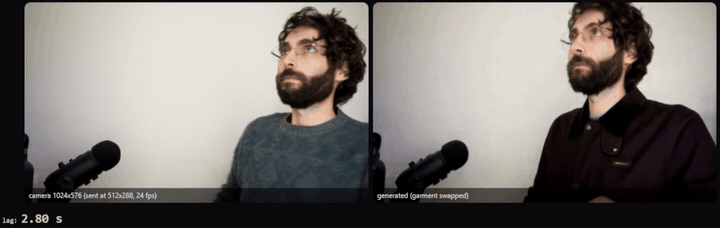

# H3 MiniMax real-time Ref2VA

Real-time video-to-video with **MiniMax-H3 Ref2VA** on a single GPU, shown here as a live virtual try-on from a webcam.



*Left: the webcam. Right: the generated stream, 512×288 on one B300, about 2.8 s behind the camera.*

This is a research and development project on how far the existing model can be pushed without training it any
further. The weights are the released ones, with the public **LightX2V Turbo 4-step LoRA**. Everything here is runtime
work: short windows, 3 denoising steps, compiled shapes, cached references and conditioning that runs ahead of the
camera.

The example application is **virtual try-on**: the browser streams webcam frames to the pod, which re-generates the
video with the person wearing a different garment and streams it back. The approach is not limited to that. Anything
Ref2VA can do from a reference image and a driving video can run through the same loop, for example near-real-time
face swapping, video avatars or immersive experiences.

Contributions are welcome, including examples of your own: see [CONTRIBUTING.md](CONTRIBUTING.md).

## Performance

Measured with a 24 fps camera, 39-frame windows (1.62 s) and 3 steps. A setting "keeps up" when each window is
generated in less time than it lasts.

| GPU (1×) | Largest setting that keeps up | Generation per 1.62 s window |
|---|---|---|
| B300 | 288×512 (or 512×288), 3 steps | 1.05–1.2 s |
| B200 | 256×448, 3 steps | 0.8–0.95 s |
| H200 | does not keep up (4–8 % short at 288×512) | |

End-to-end delay on a B300 is about 2.8 s: 1.6 s to fill a window, about 1 s until its first frames are decoded, and
0.2–0.3 s of network.

## How it works

1. **Capture.** The page captures the webcam at 24 fps, scales the frames to the session size and sends them as JPEGs
   over a WebSocket.
2. **Windows.** The server cuts the stream into windows of 39 frames. Each window is one Ref2VA call: the webcam clip
   is the video reference, the garment image is the image reference, and a fixed prompt describes the swap.
3. **Three steps.** The Turbo LoRA was distilled for 4 steps; 3 are enough at this resolution and are what makes a
   window cheaper than its own duration.
4. **Work done while frames arrive.** The webcam frames are VAE-encoded on a separate CUDA stream as they come in, so
   the encode does not wait behind the running denoise. The text and image conditioning for a window starts as soon
   as the frames it needs have arrived, 0.6 s before the window is complete. Garment latents are computed once and
   cached.
5. **Compiled shapes.** The transformer is compiled with `torch.compile` once per sequence length during warm-up.
   Garment and framing switches reuse the compiled shapes, so they cost nothing at run time.
6. **Progressive output.** The decoder produces 17-frame clips. Each clip is JPEG-encoded on the GPU and sent as soon
   as it is ready, so playback starts before the window is finished.
7. **Playback.** The page plays the received frames at 24 fps from a small buffer and shows the measured delay.

The camera's aspect ratio decides the output shape: with `ASPECTS` set, the session runs at the size closest to the
camera at the same pixel budget.

## Requirements

- A Runpod pod with one B300 or B200, an image with Python 3.12 and CUDA (measured on
  `runpod/pytorch:1.0.2-cu1281-torch280-ubuntu2404`), **250 GB of container disk** (the weights are 135 GB), and
  ports `22/tcp` and `8000/http`. A B300 needs a host with a CUDA 13 driver.
- SSH access to the pod from your machine.
- Access to the weights on Hugging Face: `MiniMaxAI/MiniMax-H3` and `lightx2v/Minimax-h3-Turbo`. They are downloaded
  on the pod and stay under the MiniMax H3 Community License; nothing in this repository contains weights.

You can create the pod by hand in the Runpod console. Optionally, `python tools/snipe_pod.py [pod-name]` polls the
stock and creates one as soon as a B300 or B200 is available. It needs:

- a Runpod API key: set `RUNPOD_API_KEY`, or run `runpodctl config --apiKey <key>` once (it writes
  `~/.runpod/config.toml`, which the script reads);
- an SSH public key in `~/.ssh/*.pub`, or `RUNPOD_PUBLIC_KEYS` set to the key(s) to inject into the pod.

## Quick start

```bash
# 1. from your machine: upload everything and install (10–15 min, mostly the 135 GB download)
bash deploy.sh root@<pod-ip> <ssh-port>

# 2. on the pod: start the server (prints READY and the URL after the warm-up)
ssh -p <ssh-port> root@<pod-ip>
nohup bash /workspace/Minimax-H3-Turbo/start_live.sh > /workspace/outputs/live.log 2>&1 < /dev/null &
tail -f /workspace/outputs/live.log

# 3. open https://<pod-id>-8000.proxy.runpod.net/?token=<token from the READY line>
```

The warm-up compiles one shape per prompt framing (about 80 s each on a cold pod). One viewer at a time: a second
connection is refused as busy.

## Options

`start_live.sh` picks the size for the GPU it finds and takes its options from the environment:

| Variable | Default | Meaning |
|---|---|---|
| `ASPECTS` | (none) | Extra output aspect ratios, e.g. `16:9,4:3,3:4,1:1`. The session runs at the one closest to the viewer's camera, at the same pixel budget. Adds warm-up time. |
| `LORA` | Turbo 4-step v0.1 | LoRA file name. `setup_live.sh` also downloads `minimax_h3_ref2v_turbo_4step_v1.0_768p_bf16.safetensors`. |
| `SHIFT` | `12` | Video shift. v0.1 was distilled at 12, v1.0 768p at 6. |
| `STEPS` | `3` | Denoising steps. |
| `SIZE` | by GPU | `WxH`, e.g. `288x512`. |
| `REF` | by GPU | Short edge of the reference canvas. |
| `TOKEN` | random | Access token in the URL. |
| `PORT` | `8000` | |

## Garments

Garments are the images in `garments/` (uploaded to `/workspace/garments`). Add your own PNG or JPG files there, one
garment per image on a plain background. The five included samples are synthetic (generated with FLUX.2 [pro] on
Runware) and show no real product.

## Checking a running server

```bash
python tools/ws_smoke.py "wss://<pod-id>-8000.proxy.runpod.net/ws?token=<token>" 6            # default size
python tools/ws_smoke.py "wss://<pod-id>-8000.proxy.runpod.net/ws?token=<token>" 6 39 1280x720  # as a 16:9 camera
```

It streams noise at 24 fps and prints, per window, the time from the last captured frame to the first output frame.
Do not run it while a browser is connected: the server serves one viewer.

## Repository layout

```
server/    live_server.py (FastAPI + WebSocket server), live.html (the page), stream_sim.py (pipeline builder and
           live-feed simulator), bench_ref2va.py (model patches and batch benchmark), shades.py (lipstick variant),
           env_live.sh (runtime environment), start_live.sh
setup/     setup_live.sh (pod install: torch for Hopper or Blackwell, diffusers 0.40, the ModelTC checkout, weights)
tools/     ws_smoke.py and ws_switch.py (headless WebSocket clients), snipe_pod.py
garments/  sample garment images
assets/    demo.gif
deploy.sh  upload + install, run from your machine
```

On the pod everything in `server/` and `tools/` sits flat inside `/workspace/Minimax-H3-Turbo`, next to the
[ModelTC/Minimax-H3-Turbo](https://github.com/ModelTC/Minimax-H3-Turbo) checkout it imports from.

## Limitations

- Resolution is low (about 147,000 pixels per frame) and quality at 3 steps is a proof of concept, not a product.
- Windows are generated independently by default, so the garment can change slightly from one window to the next.
  `live_server.py --prefix-clips` carries latents from one window into the next for continuity, at a higher cost per
  window.
- The delay cannot go below the window length plus the time to the first decoded clip.
- One viewer per GPU.
- A pod bills while it runs. Terminate it when you are done; without a network volume the weights go with it.
- Scripts must keep LF line endings (`.gitattributes` enforces it): CRLF breaks them on the pod.

## License and citation

Code and sample garments: [Apache-2.0](LICENSE). You may use, modify and sell work built on it; redistributions must
keep the copyright and [NOTICE](NOTICE). If you use it in research, a product or a demo, please cite it
([CITATION.cff](CITATION.cff); GitHub shows a "Cite this repository" button). Contributions are welcome, see
[CONTRIBUTING.md](CONTRIBUTING.md).

The MiniMax-H3 weights, the LightX2V Turbo LoRA and the ModelTC code are separate works under their own licenses; check
the MiniMax H3 Community License before any commercial use of the model.
